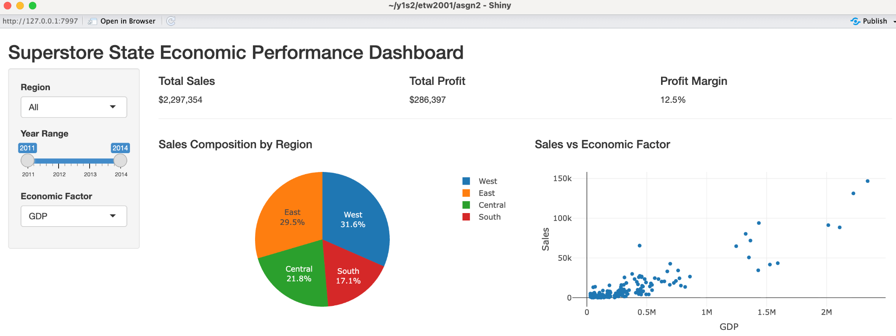
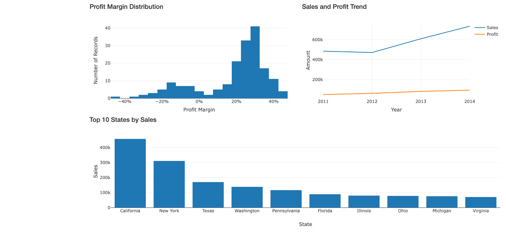
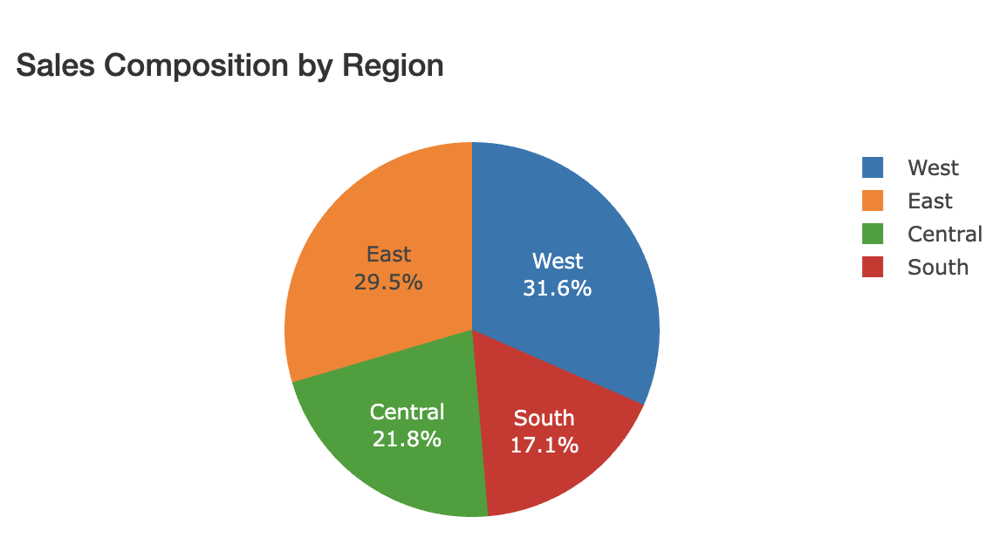
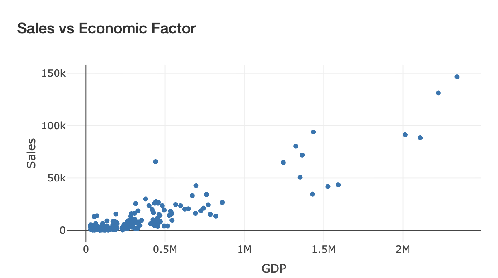
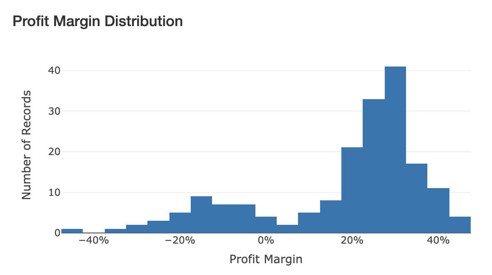
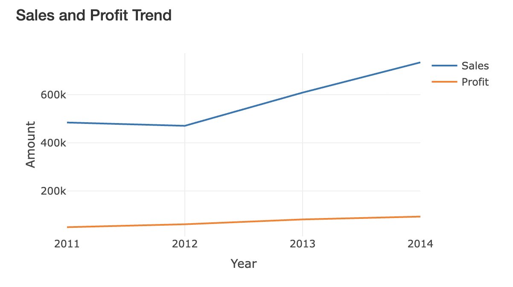
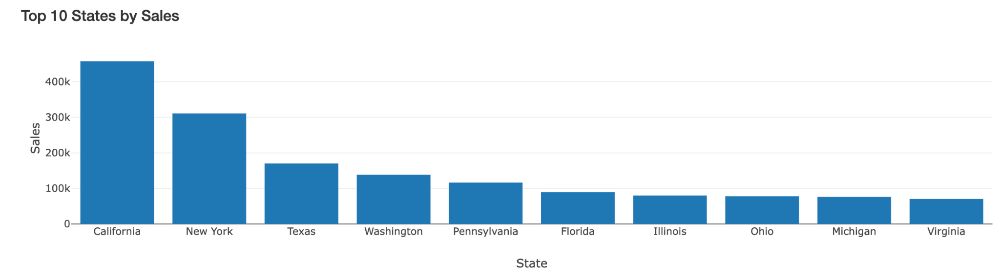
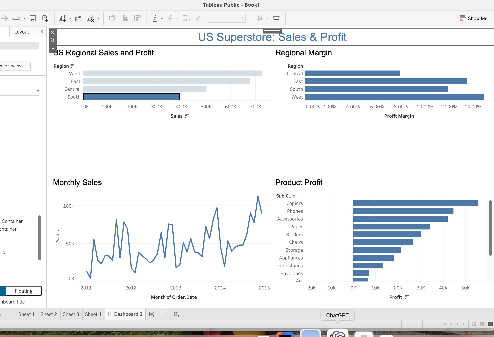

# When more sales still mean a loss

## Why I built this

I wanted to understand Superstore's US sales and profit performance from 2011 to 2014, rather than stop at a ranking of the largest markets. The R dashboard combines retail records with state GDP, population and income per capita. Tableau adds a closer look at regional margins, monthly sales and product profitability.

This write-up covers the analytical sections in my original report and adds the Tableau analysis. The [unaltered ten-page report](analysis-report.pdf), [complete text](REPORT_FULL_TEXT.md), original charts and original R code are included. Values below are checked against the supplied data; the report retains its original approximations and wording.

## Data and methods

The retail source has **51,290 global transaction rows and 27 fields**. Filtering Country to United States and Year to 2011–2014 leaves **9,994 rows**. Sales is stored as whole-dollar values in the source; I preserve those values.

`prepare_data.R` groups transactions by State, Year and Region, calculating sales, profit, quantity, distinct orders, average discount and shipping cost. It removes asterisks from state names, strips numeric thousands separators, reshapes the external year columns into long form and joins on **State + Year**.

The output contains **181 observed state-year records**, with no duplicate State-Year keys or missing GDP, population or income values. Its retail sales and profit reconcile to the filtered transaction data. Missing retail state-years are absent, rather than inserted as zero.

### Why I selected the external data

- **GDP by state:** economic size provides context for market opportunity. The report highlights California's average GDP of approximately $2,172,111 million, compared with much smaller economies such as Vermont and Wyoming.
- **Income per capita:** average income provides context for purchasing power. The report highlights the District of Columbia, approximately $68,377 across its observed records, compared with lower-income states including Mississippi, Idaho and New Mexico. These area averages do not reveal individual customer income.
- **Population:** population estimates provide market size. I selected 2011–2014 from the 2010–2019 series. California averages about 38.1 million residents over the period; Wyoming, Vermont and North Dakota are much smaller markets.

### Calculations

```text
State-year margin = state-year Profit / state-year Sales
Overall or regional margin = SUM(Profit) / SUM(Sales)
Sales per capita = Sales / Population
Profit per capita = Profit / Population
GDP dollars = GDP_Million * 1,000,000
Sales-to-GDP ratio = Sales / GDP dollars
```

The median of the 181 state-year margins is **24.4%**, while the sales-weighted overall margin is **12.5%**. They answer different questions. Similarly, summing distinct-order counts calculated separately within groups does not necessarily give a unique national order count.

## R Shiny: the five views

Region and year-range filters update the charts and summary sales, profit and margin. The economic selector switches between GDP, population and income per capita.





### 1. Composition: where do sales come from?

**Question:** How are sales distributed across US regions?



The original pie chart shows West contributing **31.6%**, East **29.5%**, Central **21.8%** and South **17.1%** of sales. West and East together account for approximately **61.1%**.

Those two regions form the main revenue base. They are sensible places to investigate product availability and capacity first. South's smaller contribution deserves attention, but the share alone does not establish weak execution: market size, store coverage and customer mix may differ. The external indicators help frame that investigation.

### 2. Relationship: does economic size explain sales?

**Question:** Is retail sales performance related to state economic size?



The scatter plot compares the selected economic factor on the horizontal axis with sales on the vertical axis. The actual R code plots **state-year observations**, identified in hover text; state totals across the full period are a separate comparison.

The broad pattern is positive: small economies tend to have lower sales, while larger economies often have higher sales. California has the highest average GDP in the included data and the highest total Superstore sales, **$457,731**. The relationship is imperfect: Texas has higher average GDP than New York, but New York has higher Superstore sales. Washington performs strongly without being one of the largest GDP states.

I would use these differences to identify markets worth studying. California, New York and Texas offer large-market opportunities; Washington may offer useful lessons about product or customer mix. GDP alone is not enough to explain sales, and this descriptive plot does not establish causation.

### 3. Distribution: are most markets profitable?

**Question:** How are profit margins distributed across state-year records?



The histogram counts state-year records, rather than transactions or distinct states. Many records fall around **20–35%** margin. The median is **24.4%** and **35 of 181 records** have negative margins. Observed margins range from approximately **-43.1% to 45.0%**. Colorado in 2014 is at the low end, around **-43.1%**; the report describes this roughly as -45%.

The positive center of the distribution is encouraging, but the negative tail matters. A market can sell products and still lose money. I would inspect the negative records by discount, shipping cost and product mix before deciding whether the issue is low demand, weak unit profitability or both. The histogram flags those questions; it does not prove their causes.

### 4. Trends: did performance improve?

**Question:** How did sales and profit change from 2011 to 2014?



| Year | Sales | Profit |
| --- | ---: | ---: |
| 2011 | $484,255 | $49,544 |
| 2012 | $470,560 | $61,619 |
| 2013 | $608,523 | $81,727 |
| 2014 | $734,016 | $93,508 |

Sales dip slightly in 2012, then rise strongly in 2013 and 2014. Profit rises throughout the period, including during the sales dip. That distinction matters: lower revenue does not automatically mean weaker profitability.

The later years are stronger overall. I would investigate which products, regions or operating changes contributed, and whether the 2012 dip reflected demand, coverage or mix. The trend does not by itself identify a successful strategy or explain the increase.

### 5. Comparison: which states deserve attention?

**Question:** Which states produce the most sales, and are those sales profitable?



California leads at **$457,731**, followed by New York at **$310,914**. Texas ranks third at **$170,187**, but records a **$25,729 loss**. Pennsylvania, Florida, Illinois and Ohio are also in the top ten by sales while having negative total profit.

This was the most useful contrast for me. A sales ranking identifies large markets, but it can hide costly growth. California and New York combine substantial sales with positive profit. Texas and Pennsylvania need a different conversation: examine discounting, shipping and product profitability before simply pursuing more volume.

## Tableau: a closer look at retail performance



[Download the editable packaged workbook](Superstore_R_Tableau.twbx?raw=true). The preview is the dashboard screenshot from the working session. Four worksheets use transaction-level retail data and the saved US data-source filter. The economic joins belong to the R workflow; they have not been added to Tableau.

### Regional sales

West has sales of **$725,514**, East **$678,834**, Central **$501,256** and South **$391,750**. The bars offer a direct comparison of the same regional composition shown in the R pie chart. The saved worksheet is titled “US Regional Sales”. Bar length encodes sales; profit is represented separately in the margin view.

### Regional margins

The calculation `SUM([Profit]) / SUM([Sales])` gives West **14.9%**, East **13.5%**, South **11.9%** and Central **7.9%**. Central sells more than South, yet turns a smaller proportion of its revenue into profit. Keeping these two charts together makes that difference visible.

### Monthly sales

The continuous monthly line reveals considerable variation within each year, with several large peaks toward the end of the period. The annual totals confirm stronger sales in 2013–2014. Individual peaks should not be labelled holiday effects or a repeatable seasonal pattern without further analysis.

### Product profit

The sub-category bars distinguish profit contributors from loss-making products. **Tables** generate **$206,968 in sales** but lose **$17,725**. **Bookcases** lose **$3,473**, and **Supplies** lose **$1,189**. Copiers, Phones and Accessories are among the stronger profit contributors. I would investigate the loss-making categories by state and discount level before recommending changes.

## The data story and next steps

Superstore grew from 2011 to 2014, but performance was uneven across regions, states and years. West and East supplied most revenue; California and New York were particularly important markets. Economic size and population provide useful market context, while exceptions such as Texas versus New York show why they cannot fully explain retail performance.

Profit changes the story. Most observed state-years were profitable, but 35 were not. Several high-sales states lost money, and substantial product sales also came with losses. Revenue growth alone is not enough.

My priorities would be to protect healthy markets such as California and New York, investigate high-sales/low-profit states such as Texas and Pennsylvania, review loss-making products, and use economic factors to develop questions about growth elsewhere. Discounting and shipping are plausible investigation leads, not established causes. Changes should be tested against transaction-level evidence.

## Limitations

This is a historical descriptive dataset, not a forecast. Superstore sales are not total state retail demand, so sales per capita is not market share. Absent retail state-years do not establish zero demand. The R app's economic averages are descriptive averages of included observations, not national population-weighted aggregates. State-year, state-total and transaction-level comparisons must remain distinct; aggregated associations do not identify individual customer behavior or causal effects.

The original R code and report are preserved. The Tableau package changes resource paths only to bundle the workbook with its data; it does not regenerate charts. The original `.twb` is also included unchanged.

## Sources and acknowledgments

The original report identifies:

- U.S. Bureau of Economic Analysis, [GDP by state](https://www.bea.gov/data/gdp/gdp-state), accessed May 29, 2026; local input `GDP.xlsx`.
- U.S. Bureau of Economic Analysis, [Personal income by state](https://www.bea.gov/data/income-saving/personal-income-by-state), accessed May 29, 2026; local input `income.xlsx`.
- kbrookshier, [US Census State Population Estimates 2010–2019](https://www.kaggle.com/datasets/kbrookshier/us-census-state-population-estimates-20102019), accessed May 29, 2026; local input `population.tsv`.
- The supplied `superstore.xlsx` is the retail source. Its upstream URL is not recorded in the report or code.

Other income links previously considered: [USA Census Income Data](https://www.kaggle.com/datasets/manishkc06/usa-census-income-data), [Poverty-Level Wages](https://www.kaggle.com/datasets/asaniczka/poverty-level-wages-in-the-usa-dataset-1973-2022), and [Incomes of 30K USA Citizens](https://www.kaggle.com/datasets/jacopoferretti/incomes-of-30k-usa-citizens). The implementation uses the BEA state income spreadsheet; these additional links are not represented as inputs to that workflow.

The report acknowledges ChatGPT assistance on May 29, 2026 with annual totals, cleaning asterisks from state names and use of `ungroup()`. Its acknowledgment is preserved in full in the original PDF and transcription. This expanded portfolio write-up and data verification were also prepared with AI assistance.
